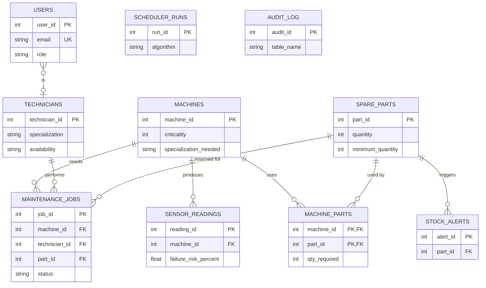

# Project Report - Predictive Maintenance Task Scheduler

## 1. Problem statement
Factories lose money when machines fail unexpectedly. We predict failures from sensor data and then solve the
scheduling problem that follows: many machines need repair, but technicians, spare parts and time are limited.
The project combines **DBMS** (reliable storage, integrity, concurrency, security) and **Operating-System** theory
(scheduling, synchronization, deadlock, memory) in one working system.

## 2. Architecture
```
Browser (login.html / index.html)
      | JSON + JWT bearer token
FastAPI backend  --  security (bcrypt, JWT, RBAC)
   |-- routers/core.py    auth, machines, predict, jobs, technicians, inventory, analytics
   |-- routers/os_lab.py  CPU, sync, deadlock, memory, disk endpoints
   |-- routers/admin.py   users, audit, backup/restore, EXPLAIN
   |-- ml/                scikit-learn model (best of 3)
   |-- os_engine/         pure-Python OS algorithms  (+ cpp_engine cross-check)
MySQL (InnoDB): tables, triggers, stored procedures, views, indexes
```

## 3. ER diagram


## 4. Normalization (why the schema is in 3NF)
* **1NF** - every column is atomic; no repeating groups (a machine's several parts are rows in `machine_parts`, not a comma list).
* **2NF** - `machine_parts(machine_id, part_id, qty_required)` has composite key; `qty_required` depends on the *whole* key. Part name/cost live in `spare_parts`, machine name/criticality in `machines`.
* **3NF** - no transitive dependency: technician name/specialization are stored once in `technicians`, jobs store only `technician_id`; priority label is derived from score, machine data is not copied into readings.
* The original project hard-coded `machine -> part` in Python (`{1:"Bearing",...}`); that mapping is now data in `machine_parts`.

## 5. DBMS features and where to find them
| Concept | Implementation |
|---|---|
| Integrity | PK, FK (`ON DELETE` rules), `CHECK`, `UNIQUE`, `ENUM`, NOT NULL |
| Indexes | `idx_sr_machine_time`, `idx_job_status_priority` (shown by `/admin/explain`) |
| Triggers | `trg_job_status_audit`, `trg_job_sync_state`, `trg_low_stock`, `trg_sensor_validate`, `trg_assign_validate` |
| Stored procedures | `sp_reserve_part` (transaction + `FOR UPDATE`), `sp_complete_job`, `sp_restock` |
| Views | `v_latest_reading`, `v_machine_health`, `v_job_details`, `v_technician_workload`, `v_inventory_status` |
| Transactions / ACID | procedures use `START TRANSACTION / COMMIT / ROLLBACK` with exit handlers; restore is all-or-nothing |
| Concurrency | `POST /os/sync/db-concurrency`: 10 sessions, stock 3 -> exactly 3 allocated, final stock 0 |
| Advanced SQL | window functions (`RANK`, `AVG OVER`, `LAG`), CTE, correlated subquery, `HAVING`, `NOT EXISTS` |
| Security | bcrypt hashes, JWT, RBAC on every endpoint, parameterised queries (no SQL injection), MySQL GRANT roles |
| Recovery | JSON backup + transactional restore; `mysqldump` also works |

## 6. OS algorithms - verified results
Test set (arrival, burst, priority): M-101 (0,4,90), M-102 (1,2,50), M-103 (2,3,75), M-104 (3,2,30), M-105 (4,5,65).

| Algorithm | Avg waiting | Avg turnaround | Avg response | Context switches |
|---|---|---|---|---|
| FCFS | 4.0 | 7.2 | 4.0 | 4 |
| SJF | 3.8 | 7.0 | 3.8 | 4 |
| SRTF | **3.4** | **6.6** | 2.6 | 5 |
| Priority | 5.4 | 8.6 | 5.4 | 4 |
| Round Robin q=2 | 5.0 | 8.2 | 2.8 | 7 |
| MLFQ | 5.4 | 8.6 | **2.0** | 7 |

Hand-check FCFS: completions 4,6,9,11,16 -> turnaround 4,5,7,8,12 (avg 7.2) -> waiting 0,3,4,6,7 (avg 4.0). OK.
Other textbook checks built into the tests: Banker's safe sequence P1,P3,P4,P0,P2; disk FCFS = 640 and SSTF = 236 head movements; FIFO Belady anomaly 9 vs 10 faults.

## 7. Viva questions you should be able to answer
**DBMS**
1. *Why `SELECT ... FOR UPDATE` in `sp_reserve_part`?* It locks the stock row so two sessions cannot both read "1 left" and both take it (lost update). Proven by the concurrency test.
2. *Why triggers instead of Python code?* The rule is enforced even if someone updates the table from another tool.
3. *Difference between a view and a table?* A view stores a query, not data; `v_machine_health` always shows the latest reading.
4. *What does the index change?* `EXPLAIN` shows `key = idx_job_status_priority` instead of a full table scan.
5. *Which isolation level?* InnoDB default REPEATABLE READ; row locks add serialisation exactly where we need it.
6. *Why a bridge table?* A machine uses many parts and a part fits many machines (M:N) - needed for 2NF/3NF.

**OS**
1. *Why does SRTF give the lowest waiting time but is not used blindly?* It can starve long jobs; our Priority + aging and HRRN variants remove starvation.
2. *Where is a semaphore used?* The technician pool: at most K jobs run at once, others block on `acquire()`.
3. *Mutex vs semaphore?* Mutex = one owner, mutual exclusion; semaphore = counting resource (K technicians).
4. *Deadlock conditions?* Mutual exclusion, hold & wait, no pre-emption, circular wait. Banker's removes the risk by only granting requests that leave a **safe** state.
5. *Where is LRU used for real?* `/machines/{id}/detail` cache (capacity 4) - see hit/miss/eviction counters.
6. *Belady's anomaly?* FIFO can fault more with more frames - shown in the Memory tab.
